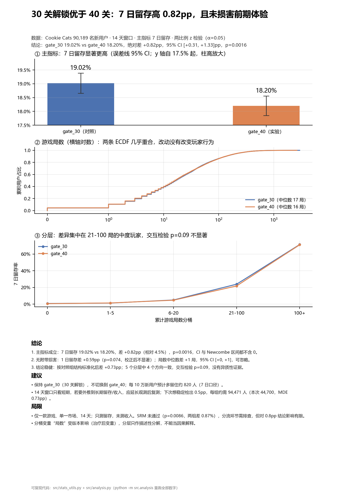

# Cookie Cats 关卡门槛 A/B 测试：30 关 vs 40 关

> **一句话结论：维持 30 关解锁。** 7 日留存 19.02% vs 18.20%（+0.82pp，95% CI [+0.31, +1.33]pp，p=0.0016），
> 次日留存与游戏局数没有显著差异，没有证据显示改动损害了前期体验。



> 一页版：[reports/one_pager.pdf](reports/one_pager.pdf) · 可复现管道：`python -m src.analysis`

---

## 1. 问题（业务背景）

Cookie Cats 是一款三消休闲游戏。在第 30 关有一个"强制等待"门槛（ gate）：玩家必须等一段时间或邀请好友才能继续。
产品团队想验证：**把门槛从第 30 关后移到第 40 关，能不能提升留存？**

- 对照组 `gate_30`：30 关后设门槛（44,700 人）
- 实验组 `gate_40`：40 关后设门槛（45,489 人）
- 数据：90,189 名新用户，14 天观测窗口，来自 Kaggle *Mobile Games A/B Testing* 数据集

**决策问题**：改不改门槛？如果改，预期收益和风险是什么？

## 2. 数据

| 字段 | 含义 |
| --- | --- |
| `userid` | 用户 ID |
| `version` | 分组：`gate_30`（对照）/ `gate_40`（实验） |
| `sum_gamerounds` | 14 天内累计游戏局数 |
| `retention_1` | 次日是否回访（0/1） |
| `retention_7` | 第 7 天是否回访（0/1） |

- 90,189 行 × 5 列，无缺失、无重复 userid
- 两组人数 44,700 vs 45,489，相对差 0.875%
- 局数是极端长尾：中位数 16 局，均值 51.9 局，最大 49,854 局（单个真实玩家）

## 3. 方法

| 问题 | 方法 | 代码 |
| --- | --- | --- |
| 分流是否均衡 | 卡方 SRM 检验 | `srm_check` |
| 主指标差异 | 两比例 z 检验（合并 SE）+ Wald/Newcombe CI | `two_proportion_test` |
| 单组留存区间 | Wilson 区间 | `wilson_interval` |
| 局数差异（长尾） | 中位数差值 + bootstrap 百分位区间 | `bootstrap_diff` |
| 分层是否一致 | 分桶 + 直接标准化 + 逻辑回归交互 LR 检验 | `notebooks/02_test.ipynb` |
| 实验够不够用 | 功效 / MDE / 所需样本量 | `achieved_power`、`min_detectable_delta`、`required_sample_size` |
| 多指标 | Bonferroni 校正 | `bonferroni` |

**为什么主指标是 7 日留存**：它更接近"玩家是否真的留下来"，对短期波动不敏感；
次日留存容易受推送、周末等因素影响，作为次要指标监控体验是否受损。

**为什么局数不用 t 检验**：长尾分布 + 单个 49,854 局的玩家会把均值抬高约 1.1 局，
均值差几乎全部来自这一个人；改用中位数 + bootstrap，不依赖正态假设。

## 4. 结论（全部数字可由 `python -m src.analysis` 复现）

### 4.1 主指标：7 日留存

| 组 | 留存率 | 95% Wilson CI |
| --- | --- | --- |
| gate_30（对照） | **19.02%** | [18.66%, 19.39%] |
| gate_40（实验） | **18.20%** | [17.85%, 18.56%] |

- 绝对差 **+0.82pp**，95% CI **[+0.31, +1.33]pp**（Wald 与 Newcombe 一致）
- 相对提升 **+4.51%**，z=3.164，**p=0.0016**
- 结论：**显著**，且区间下界仍为正

### 4.2 次要指标

| 指标 | 对照 | 实验 | 差值 | 95% CI | p |
| --- | --- | --- | --- | --- | --- |
| 次日留存 | 44.82% | 44.23% | +0.59pp | [-0.06, +1.24]pp | 0.074 |
| 局数中位数 | 17 | 16 | +1 局 | [0, +1] 局 | bootstrap |

- 次日留存不显著（Bonferroni 校正后阈值 0.025，仍不显著）
- 局数中位数差 1 局、CI 贴着 0，业务上可忽略
- **没有"留存上升但体验变差"的证据**

### 4.3 分层（按累计局数）

| 桶 | 对照 | 实验 | 差 |
| --- | --- | --- | --- |
| 0 | 0.83% | 0.63% | +0.19pp |
| 1-5 | 1.29% | 1.44% | -0.15pp |
| 6-20 | 5.03% | 4.75% | +0.28pp |
| 21-100 | 23.93% | 21.84% | **+2.09pp** |
| 100+ | 71.39% | 71.24% | +0.15pp |

- 按对照组结构标准化后差 **+0.73pp**，方向与粗率一致 → **无辛普森悖论**
- 交互项 LR 检验 p=0.092 → 没有足够证据说各桶效应不同
- 但效应主要集中在 21-100 局的中度玩家，报告需注明

### 4.4 这个实验够不够用

- 每组 44,700 人，对 0.82pp 效应的功效约 **88%**
- 80% 功效下的 **MDE = 0.73pp**
- 想稳定检出 0.5pp / 1pp / 2pp，每组分别需要 **94,471 / 23,862 / 6,084** 人

## 5. 建议与决策

**决策：维持 gate_30（30 关解锁），不切换到 gate_40。**

理由：

1. 主指标显著更高，CI 下界 +0.31pp 仍为正，最保守估计也是净收益；
2. 次要指标没有受损迹象；
3. 效应量约 4.5% 相对提升，按 10 万新增估算约多留 820 人（7 日口径）。

风险与前提：

- 14 天窗口只覆盖短期留存，长期留存/付费可能不同，不能直接外推；
- SRM 未通过（p=0.009），偏差 0.87% 虽小，仍需排查分流与埋点；
- 效应集中在中度玩家，其他分层的样本不足以单独下结论；
- 只测了留存，没有收入/广告指标，无法评估变现影响。

**若业务坚持要上 40 关**：做一次预注册实验，主指标固定为 7 日留存，每组至少 9.4 万人（检出 0.5pp），
观测窗口 ≥ 28 天，并同时监控 ARPU 与广告展示。

## 6. 局限

1. **观测窗口短**：14 天，7 日留存是短期指标；长期留存、付费、流失都没覆盖。
2. **单游戏、单市场**：结论不能直接迁移到其他产品或地区。
3. **只有二元留存**：没有使用时长、关卡进度、付费等更细的指标。
4. **SRM 技术性未通过**：0.87% 的偏差虽小，但严格流程下应先排查再决策。
5. **分层变量是治疗后变量**：局数受版本影响，分层只能做描述性分解，不是因果中介分析。

## 7. 常见疑问（面试高频 8 问）

**Q1 业务问题是什么？**
把新手门槛从 30 关后移到 40 关，能否提升留存；用 7 日留存做主指标，决策是改不改门槛。

**Q2 为什么 7 日留存做主指标，而不是次日留存或局数？**
7 日留存更贴近"留下来"这个业务目标，噪声比次日小；次日留存和局数作为"体验是否受损"的护栏指标。
主指标只能有一个，否则就是挑显著的讲（p-hacking）。

**Q3 SRM p 值多少？怎么处理？**
p=0.0086（卡方 6.90），技术上未通过，但两组只差 0.87%。处理方式：记录并排查分流日志/埋点；
评估其对结论的影响（远小于 0.8pp 的效应），不直接推翻实验，但在报告里披露。

**Q4 主指标的绝对差、相对提升、置信区间是多少？**
+0.82pp，相对 +4.51%，95% CI [+0.31, +1.33]pp，p=0.0016；Newcombe 区间一致。

**Q5 分层后结论变不变？有没有辛普森悖论？**
不变。标准化后 +0.73pp，方向一致；交互检验 p=0.09，无异质性证据。但效应集中在 21-100 局玩家。

**Q6 检验力够不够？如果重做怎么设计？**
对 0.82pp 功效 88%，MDE 0.73pp；对 0.5pp 不够（需每组 9.4 万人）。
重做：先定业务最小可感知效应（如 0.5pp），按公式算样本量并留 10-20% 缓冲，预注册主指标，固定样本量或使用序贯检验。

**Q7 改不改 gate？给明确答案。**
不改，维持 gate_30。风险：短期指标可能不代表长期；SRM 需排查；效应集中在中度玩家。

**Q8 这个分析最大的局限是什么？**
14 天窗口 + 单游戏 + 只测留存不测收入；结论是"这个窗口内、这个指标上"的结论，不能无限外推。

> 更完整的问答与 2 分钟口述稿见 [notes/面试问答.md](notes/面试问答.md) 和 [notes/口述稿.md](notes/口述稿.md)；
> 想自己从零重写这个项目，按 [notes/教学笔记.md](notes/教学笔记.md) 的十天路线走。

## 8. 复现方式

```bash
git clone https://github.com/XXY-bkb/cookie-cats.git
cd cookie-cats
pip install -r requirements.txt

# 1) 重跑全部统计与图（约 1 分钟，bootstrap 占大头）
python -m src.analysis

# 2) 重新生成一页结论
python -m reports.make_one_pager

# 3) 单元测试
python -m unittest discover -s tests -v

# 4) notebook（可选，需要 jupyter）
jupyter notebook notebooks/
```

输出：

- `reports/results.json`：全部统计量，供报告/下游复用
- `reports/figures/*.png`：6 张过程图
- `reports/one_pager.png|pdf`：一页结论

## 9. 仓库结构

```
cookie-cats/
├─ data/raw/cookie_cats.csv      # 原始数据（Kaggle）
├─ notebooks/
│  ├─ 01_eda.ipynb               # 数据体检、SRM、长尾、ECDF
│  └─ 02_test.ipynb              # 主/次要指标、分层、功效、决策
├─ src/
│  ├─ stats_utils.py             # 统计工具（带中文注释与公式说明）
│  ├─ plots.py                   # 报告用图
│  └─ analysis.py                # 一键复现管道
├─ reports/
│  ├─ make_one_pager.py          # 一页结论生成
│  ├─ results.json               # 统计结果
│  ├─ figures/                   # 过程图
│  └─ one_pager.png|pdf          # 交付物
├─ tests/test_stats_utils.py     # 25 个单元测试
├─ notes/                        # 面试问答、口述稿、教学笔记
└─ requirements.txt
```

## 10. 关于"网上的结论"

这份数据在网上被分析过很多次，常见说法包括"两组没有显著差异（p≈0.19）"。**本仓库的结论与之不同**，
原因通常是口径差异，而不是数据被改过：

- 双侧 vs 单侧检验；
- 是否剔除极端局数用户（注意：剔除后 7 日留存的**比例**几乎不变，因为留存是 0/1）；
- 主指标选的是次日留存（p=0.074，确实不显著）还是 7 日留存（p=0.0016）；
- 是否对多指标做校正。

**判断方法**：不要抄结论，跑 `python -m src.analysis` 看自己的数字；报告里写清口径。
这也是本项目的核心训练目标——**同一份数据，方法不同，结论可以完全不同**。

## 数据来源

Kaggle: *Mobile Games A/B Testing — Cookie Cats*（公开数据集，仅用于学习）。
数据文件已放在 `data/raw/cookie_cats.csv`，可直接复现。
